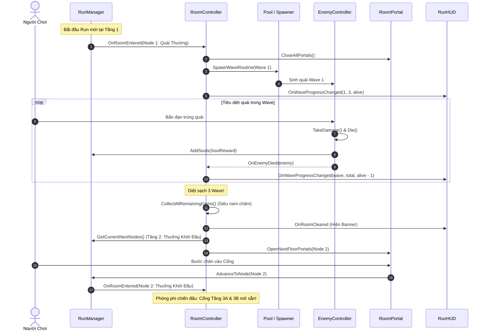

# TÀI LIỆU HỆ THỐNG HẦM NGỤC 13 TẦNG PHÂN NHÁNH TUYẾN TÍNH (SLAY THE SPIRE STYLE)
**Dự án:** *Project_D* (Unity 6 URP 2D Mobile Action Survivor x Dungeon Crawler)  
**Tác giả:** Antigravity AI Senior Game Developer  
**Ngày hoàn thiện:** 23/10/2026  

---

## MỤC LỤC
1. [Tổng Quan & Tầm Nhìn Kiến Trúc](#1-tổng-quan--tầm-nhìn-kiến-trúc)
2. [Sơ Đồ Đồ Thị 13 Tầng Cố Định (13-Floor Run Graph)](#2-sơ-đồ-đồ-thị-13-tầng-cố-định-13-floor-run-graph)
3. [Chi Tiết Các Module & Chức Năng Cốt Lõi](#3-chi-tiết-các-module--chức-năng-cốt-lõi)
   - 3.1. [Khung Dữ Liệu Hành Trình & Quản Trị Run (Run System)](#31-khung-dữ-liệu-hành-trình--quản-trị-run-run-system)
   - 3.2. [Cơ Chế Chiến Đấu 3-4 Wave (RoomController)](#32-cơ-chế-chiến-đấu-3-4-wave-roomcontroller)
   - 3.3. [Cổng Dịch Chuyển Vật Lý & Icon Nhận Diện (In-World Portals)](#33-cổng-dịch-chuyển-vật-lý--icon-nhận-diện-in-world-portals)
   - 3.4. [Kinh Tế Linh Hồn (Souls Economy)](#34-kinh-tế-linh-hồn-souls-economy)
   - 3.5. [Các Phòng Phi Chiến Đấu & Điểm Tương Tác (Interactions)](#35-các-phòng-phi-chiến-đấu--điểm-tương-tác-interactions)
   - 3.6. [Giao Diện Người Dùng (RunHUD & VictoryUI)](#36-giao-diện-người-dùng-runhud--victoryui)
   - 3.7. [Hệ Thống Biến Thể Phòng Động (RoomManager & RoomLayout)](#37-hệ-thống-biến-thể-phòng-động-roommanager--roomlayout)
   - 3.8. [Bộ Công Cụ Tạo Phòng Trong Unity Editor (RoomCreatorWizard)](#38-bộ-công-cụ-tạo-phòng-trong-unity-editor-roomcreatorwizard)
4. [Luồng Dữ Liệu & Vòng Đời 1 Lượt Chơi (Data Flow & Lifecycle)](#4-luồng-dữ-liệu--vòng-đời-1-lượt-chơi-data-flow--lifecycle)
5. [Hướng Dẫn Thiết Lập & Tích Hợp Trên Unity Editor](#5-hướng-dẫn-thiết-lập--tích-hợp-trên-unity-editor)

---

## 1. TỔNG QUAN & TẦM NHÌN KIẾN TRÚC

Hệ thống biến trò chơi từ một màn chơi vô tận đơn điệu thành một **hành trình phiêu lưu Roguelite phân nhánh tuyến tính** chuẩn mực theo phong cách kinh điển của *Slay the Spire*.

### Các nguyên tắc vàng được áp dụng:
1. **Chỉ tiến không lùi (Linear-Forward Progression):** Mọi lựa chọn rẽ nhánh đều có ý nghĩa chiến lược. Người chơi phải tự cân nhắc giữa việc mạo hiểm vào phòng **Tinh Anh (Elite)** để lấy phần thưởng lớn hay đi vào phòng an toàn **Lửa Trại (Rest Site)** để hồi phục thể lực.
2. **Cổng Dịch Chuyển Trực Quan (In-World Portals):** Không chỉ xem bản đồ dạng nút bấm tĩnh, khi dọn sạch phòng, các Cổng dịch chuyển sẽ xuất hiện ngay trong không gian 2D với **biểu tượng icon riêng biệt**. Người chơi tự điều khiển nhân vật bước vào cổng mình chọn.
3. **Chiến đấu theo Wave (Multi-Wave Combat):** Phòng chiến đấu không sinh quái vô tận nữa mà diễn ra qua **3 đến 4 Wave**. Tiêu diệt sạch quái của toàn bộ các đợt mới được tính là Hoàn thành phòng (Room Cleared).
4. **Souls cộng thẳng (Zero Pickup Delay):** Hạ gục quái vật sẽ nhận ngay điểm Linh Hồn (Souls) để phục vụ chi tiêu tại Lửa Trại hoặc Cửa Hàng.
5. **Thiết kế hướng mở (Modular Design):** Người thiết kế game (bạn) có thể tự do xây dựng các phòng đấu trường với địa hình, kích thước, chướng ngại vật tùy ý; code quản lý phòng và cổng là các component độc lập, chỉ cần gắn vào là chạy.

---

## 2. SƠ ĐỒ ĐỒ THỊ 13 TẦNG CỐ ĐỊNH (13-FLOOR RUN GRAPH)

Hành trình gồm đúng **13 Tầng** với 22 Nút liên thông hoàn chỉnh (không bao giờ có ngõ cụt):

```
Tầng 1:   [ 1: Quái Thường ]
                 │
Tầng 2:   [ 2: Thưởng Khởi Đầu ]
                ╱  ╲
Tầng 3:   [ 3A: Quái ]   [ 3B: Quái ]
           ╱    ╲     ╱    ╲
Tầng 4: [ 4: Shop ]  [ 4: Buff ]  [ 4: Rest ]
           ╲    ╱     ╲    ╱
Tầng 5:   [ 5A: Quái ]   [ 5B: Elite ]
           ╱    ╲     ╱    ╲
Tầng 6: [ 6: Rest ]  [ 6: Shop ]
           ╲         ╱
Tầng 7:   [ 7: MINI BOSS ] (Hội tụ)
                 │
Tầng 8:   [ 8: Buff Lớn Sau Mini Boss ]
                ╱  ╲
Tầng 9:   [ 9A: Quái ]   [ 9B: Elite ]
           ╱    ╲     ╱    ╲
Tầng 10: [ 10: Buff ] [ 10: Rest ]
           ╱    ╲     ╱    ╲
Tầng 11: [ 11A: Quái ] [ 11B: Elite ] [ 11C: Elite ]
           ╲         │         ╱
Tầng 12:   [ 12: Lửa Trại Hồi Máu ] (Hội tụ chuẩn bị)
                 │
Tầng 13:   [ 13: TRÙM CUỐI BOSS ]
                 │
          🏆 CHIẾN THẮNG RUN!
```

---

## 3. CHI TIẾT CÁC MODULE & CHỨC NĂNG CỐT LÕI

### 3.1. Khung Dữ Liệu Hành Trình & Quản Trị Run (Run System)

#### A. `RunNodeType.cs`
File: [Assets/_Project/Scripts/Dungeon/Run/RunNodeType.cs](file:///d:/Project_D/Assets/_Project/Scripts/Dungeon/Run/RunNodeType.cs)
- Định nghĩa 9 loại phòng riêng biệt:
  - `NormalBattle`: Quái thường (3 đợt).
  - `StarterReward`: Bệ nhận thưởng khởi đầu (Tầng 2).
  - `EliteBattle`: Quái tinh anh nguy hiểm, chỉ số cao (4 đợt).
  - `MiniBoss`: Trận chiến Mini Boss tại Tầng 7.
  - `BigReward`: Rương báu buff lớn sau khi hạ Mini Boss (Tầng 8).
  - `RestSite`: Lửa trại nghỉ ngơi, hồi máu (Tầng 4, 6, 10, 12).
  - `Shop`: Cửa hàng mua vật phẩm/thẻ bài bằng Souls (Tầng 4, 6).
  - `BuffReward`: Bệ thờ nhận buff ngẫu nhiên (Tầng 4, 10).
  - `BossBattle`: Trận chiến Trùm Cuối quyết định (Tầng 13).

#### B. `RunNodeData.cs`
File: [Assets/_Project/Scripts/Dungeon/Run/RunNodeData.cs](file:///d:/Project_D/Assets/_Project/Scripts/Dungeon/Run/RunNodeData.cs)
- Chứa toàn bộ thông tin của 1 nút trên đồ thị:
  - `Id`: Mã định danh số nguyên duy nhất (1 đến 22).
  - `FloorNumber`: Số tầng (1 đến 13).
  - `BranchName`: Tên nhánh (ví dụ: "3A", "4-Shop", "11B-Elite"...).
  - `NodeType`: Loại phòng.
  - `DisplayName`: Tên tiếng Việt hiển thị trên UI và Cổng dịch chuyển.
  - `NodeColor`: Màu sắc chủ đạo đại diện cho phòng.
  - `NextNodeIds`: Danh sách các Node ở tầng kế tiếp mà nút này dẫn tới.
  - Thuộc tính `IsCombatRoom`: Tự động trả về `true` nếu là phòng đánh quái (`NormalBattle`, `EliteBattle`, `MiniBoss`, `BossBattle`).

#### C. `RunMapConfigSO.cs`
File: [Assets/_Project/Scripts/Dungeon/Run/RunMapConfigSO.cs](file:///d:/Project_D/Assets/_Project/Scripts/Dungeon/Run/RunMapConfigSO.cs)
- ScriptableObject cấu hình toàn bộ đồ thị 13 tầng.
- Tích hợp sẵn hàm `BuildDefault13FloorRunMap()` tự động xây dựng cây 22 nút liên kết chuẩn ngay khi tạo hoặc lúc runtime nếu chưa có asset.

#### D. `RunManager.cs`
File: [Assets/_Project/Scripts/Dungeon/Run/RunManager.cs](file:///d:/Project_D/Assets/_Project/Scripts/Dungeon/Run/RunManager.cs)
- Singleton quản lý xuyên suốt 1 lượt chơi:
  - Theo dõi `CurrentFloor` và `CurrentNode`.
  - Quản lý quỹ tiền tệ `CurrentSouls`.
  - Hàm `AdvanceToNode(int nextNodeId)`: Chuyển sang nút tiếp theo, bắn sự kiện `OnFloorChanged` và `OnRoomEntered`.
  - Hàm `AddSouls(int amount)` / `SpendSouls(int amount)`: Cộng/trừ Souls an toàn, tự động kích hoạt `OnSoulsChanged`.
  - Hàm `CompleteRun()`: Kích hoạt khi hạ gục Boss Tầng 13, bắn sự kiện `OnRunCompleted`.
  - Hàm `GetCurrentNextNodes()`: Trả về danh sách các Node nhánh rẽ kế tiếp để sinh Cổng dịch chuyển.

---

### 3.2. Cơ Chế Chiến Đấu 3-4 Wave (RoomController)

#### A. `WaveConfig.cs` & `RoomWaveConfigSO.cs`
Files:
- [Assets/_Project/Scripts/Dungeon/Room/WaveConfig.cs](file:///d:/Project_D/Assets/_Project/Scripts/Dungeon/Room/WaveConfig.cs)
- [Assets/_Project/Scripts/Dungeon/Room/RoomWaveConfigSO.cs](file:///d:/Project_D/Assets/_Project/Scripts/Dungeon/Room/RoomWaveConfigSO.cs)
- Định nghĩa từng Wave gồm: Tên đợt, số lượng quái xuất hiện (`enemyCount`), khoảng cách sinh quái (`spawnInterval`), và danh sách kẻ địch (`enemyTypes`).
- Cung cấp sẵn các mẫu chuẩn:
  - **Phòng Quái Thường (3 Waves):** Đợt 1 (6 quái) $\to$ Đợt 2 (10 quái) $\to$ Đợt 3 (15 quái).
  - **Phòng Tinh Anh / Boss (4 Waves):** Đợt 1 (8 quái) $\to$ Đợt 2 (14 quái) $\to$ Đợt 3 (18 quái) $\to$ Đợt 4 (22 quái).

#### B. `RoomController.cs`
File: [Assets/_Project/Scripts/Dungeon/Room/RoomController.cs](file:///d:/Project_D/Assets/_Project/Scripts/Dungeon/Room/RoomController.cs)
- **Bộ não điều phối đấu trường:**
  1. Khi người chơi bước vào phòng chiến đấu:
     - Tự động đóng/ẩn toàn bộ các Cổng dịch chuyển.
     - Ẩn các điểm tương tác phi chiến đấu.
     - Tự động dừng Spawner vô tận cũ (`legacySpawner.StopSpawning()`).
     - Tự động Prewarm trước các Prefab quái và ngọc Exp vào `PoolManager` để loại bỏ 100% hiện tượng khựng khung hình (Zero GC Spike).
     - Khởi chạy Coroutine sinh quái cho Wave 1.
  2. Trong trận đấu:
     - Lắng nghe sự kiện `EnemyController.OnEnemyDied`.
     - Giảm biến đếm `_aliveEnemiesInRoom` và cập nhật thông số lên `RunHUD`.
     - Khi hết quái trong Wave $\to$ Chờ độ trễ $1.5\text{s}$ $\to$ Kích hoạt Wave kế tiếp.
  3. Khi dọn sạch toàn bộ các Wave:
     - Gọi `CollectAllRemainingGems()`: Kích hoạt siêu nam châm hút toàn bộ ngọc Exp rơi rải rác trên sàn về người chơi.
     - Mở các Cổng dịch chuyển dẫn sang tầng tiếp theo (`OpenNextFloorPortals()`).
     - Bắn sự kiện `OnRoomCleared`.
  4. Nếu là phòng phi chiến đấu (Rest, Shop, Buff):
     - Mở sẵn toàn bộ các Cổng dịch chuyển sang tầng sau ngay từ đầu.
     - Kích hoạt Điểm Tương Tác vật lý tương ứng.

---

### 3.3. Cổng Dịch Chuyển Vật Lý & Icon Nhận Diện (In-World Portals)

#### A. `PortalVisualConfigSO.cs`
File: [Assets/_Project/Scripts/Dungeon/Room/PortalVisualConfigSO.cs](file:///d:/Project_D/Assets/_Project/Scripts/Dungeon/Room/PortalVisualConfigSO.cs)
- Cấu hình biểu tượng và màu sắc riêng biệt cho từng loại phòng:
  - ⚔️ **Quái Thường:** Màu đỏ kiếm (`#E64D4D`), Icon/Ký tự Song Kiếm.
  - 💀 **Tinh Anh (Elite):** Màu hồng tím đậm (`#F2268C`), Icon/Ký tự Đầu Lâu.
  - 👹 **Mini Boss:** Màu tím quỷ (`#D933E6`), Icon/Ký tự Mặt Quỷ.
  - 👑 **Boss:** Màu đỏ rực (`#FF261A`), Icon/Ký tự Vương Miện.
  - 🏕️ **Hồi Máu (Rest Site):** Màu xanh lá (`#33E659`), Icon/Ký tự Lửa Trại.
  - 💰 **Cửa Hàng (Shop):** Màu vàng kim (`#FFD933`), Icon/Ký tự Túi Tiền.
  - 📜 **Nhận Buff:** Màu xanh dương (`#66B3FF`), Icon/Ký tự Cuộn Giấy Buff.
  - 🎁 **Thưởng Khởi Đầu:** Màu xanh lam ngọc (`#4DCCFF`), Icon/Ký tự Hộp Quà.
  - ⭐ **Thưởng Lớn Mini Boss:** Màu vàng sao (`#FFCC1A`), Icon/Ký tự Ngôi Sao.

#### B. `RoomPortal.cs`
File: [Assets/_Project/Scripts/Dungeon/Room/RoomPortal.cs](file:///d:/Project_D/Assets/_Project/Scripts/Dungeon/Room/RoomPortal.cs)
- Đặt trực tiếp trong thế giới 2D:
  - Có hiệu ứng nhịp thở sống động (Pulsing scale nhẹ nhàng).
  - Đổi màu viền và hiển thị rõ ràng Tên tầng, Tên phòng và Icon đại diện.
  - Bắt va chạm `OnTriggerEnter2D`: Khi người chơi bước vào, khóa cổng tạm thời và gọi `RunManager.Instance.AdvanceToNode(_targetNode.Id)` để dịch chuyển sang tầng mới.

---

### 3.4. Kinh Tế Linh Hồn (Souls Economy)

- **Cộng thẳng khi diệt quái:**
  - Trong [EnemyDataSO.cs](file:///d:/Project_D/Assets/_Project/Scripts/Enemies/EnemyDataSO.cs#L17), đã thêm thuộc tính `_soulReward` (Quái thường: 2 Souls, Elite: 10 Souls, Boss: 50 Souls).
  - Trong [EnemyController.cs](file:///d:/Project_D/Assets/_Project/Scripts/Enemies/EnemyController.cs#L293), hàm `Die()` tự động gọi:
    ```csharp
    RunManager.Instance?.AddSouls(_data.SoulReward);
    ```
    Người chơi nhận Souls ngay lập tức, không cần nhặt nhạnh rơi vãi trên sàn.
- **Chi tiêu Souls:**
  - Hồi đầy 100% sinh lực tại Lửa Trại (Rest Site).
  - Mua bình máu khẩn cấp và các thẻ nâng cấp vĩnh viễn tại Cửa Hàng (Shop).

---

### 3.5. Các Phòng Phi Chiến Đấu & Điểm Tương Tác (Interactions)

#### A. `InteractionPoint.cs`
File: [Assets/_Project/Scripts/Dungeon/Interactions/InteractionPoint.cs](file:///d:/Project_D/Assets/_Project/Scripts/Dungeon/Interactions/InteractionPoint.cs)
- Đặt tại vị trí vật thể tương tác trong phòng (Đống lửa trại, Quầy thương nhân, Bệ đá buff).
- Tự động hiện bong bóng nhắc nhở ("Chạm để tương tác") khi người chơi đi vào bán kính.
- Khi người chơi chạm vào, tự động kích hoạt bảng UI chức năng tương ứng:
  - `RestSite` $\to$ Mở [RestSiteUI](file:///d:/Project_D/Assets/_Project/Scripts/Dungeon/UI/RestSiteUI.cs).
  - `Shop` $\to$ Mở [ShopUI](file:///d:/Project_D/Assets/_Project/Scripts/Dungeon/UI/ShopUI.cs).
  - `BuffReward` $\to$ Mở giao diện bốc thẻ bài nâng cấp.

#### B. `RestSiteUI.cs`
File: [Assets/_Project/Scripts/Dungeon/UI/RestSiteUI.cs](file:///d:/Project_D/Assets/_Project/Scripts/Dungeon/UI/RestSiteUI.cs)
- Quản lý qua `CanvasGroup` (Zero lag):
  - **Lựa chọn 1 (Miễn phí):** "Nghỉ Ngơi Tĩnh Dưỡng" $\to$ Gọi `PlayerHealth.Instance.HealPercent(0.3f)` hồi phục 30% Máu tối đa.
  - **Lựa chọn 2 (50 Souls):** "Cầu Nguyện Linh Hồn" $\to$ Trừ 50 Souls qua `RunManager.Instance.SpendSouls(50)` và gọi `PlayerHealth.Instance.HealFull()` hồi đầy 100% Máu. Nút này tự động khóa nếu không đủ Souls.
  - **Nút Đóng / Rời đi:** Người chơi có thể đóng bảng bất kỳ lúc nào để bước qua cổng sang tầng sau.

#### C. `ShopUI.cs`
File: [Assets/_Project/Scripts/Dungeon/UI/ShopUI.cs](file:///d:/Project_D/Assets/_Project/Scripts/Dungeon/UI/ShopUI.cs)
- Bày bán 4 mặt hàng chiến lược:
  1. **Bình Máu Khẩn Cấp:** Hồi +40 HP (Giá: 20 Souls).
  2. **Nâng Cấp Sát Thương:** Tăng vĩnh viễn +5 Damage đạn (Giá: 45 Souls).
  3. **Nâng Cấp Tốc Bắn:** Tăng vĩnh viễn +20% Fire Rate (Giá: 35 Souls).
  4. **Nâng Cấp Đạn Chùm:** Bắn thêm +1 viên đạn mỗi loạt (Giá: 60 Souls).
- Tự động hiển thị số dư Souls và khóa các nút mua nếu không đủ tiền.

---

### 3.6. Giao Diện Người Dùng (RunHUD & VictoryUI)

#### A. `RunHUD.cs`
File: [Assets/_Project/Scripts/Dungeon/UI/RunHUD.cs](file:///d:/Project_D/Assets/_Project/Scripts/Dungeon/UI/RunHUD.cs)
- Hiển thị góc trên màn hình:
  - **Tầng hiện tại:** `TẦNG X / 13` kèm tên phòng theo màu sắc chủ đạo.
  - **Quỹ Souls:** `💎 125 Souls`.
  - **Tiến độ Wave trong trận:** `ĐỢT: 2 / 3` kèm số lượng `Quái còn lại: 5`.
  - **Banner Chiến Thắng:** Tự động hiện thông báo `🎉 PHÒNG ĐÃ DỌN SẠCH! HÃY BƯỚC VÀO CỔNG` trong 2.5 giây khi hạ gục quái đợt cuối.

#### B. `VictoryUI.cs`
File: [Assets/_Project/Scripts/Dungeon/UI/VictoryUI.cs](file:///d:/Project_D/Assets/_Project/Scripts/Dungeon/UI/VictoryUI.cs)
- Tự động kích hoạt khi hạ gục Trùm Cuối tại Tầng 13:
  - Tạm dừng thế giới game (`Time.timeScale = 0f`).
  - Bảng tổng kết vinh danh: Thời gian hoàn thành Run, Cấp độ đạt được, Tổng số Linh Hồn tích lũy.
  - Nút **"Chơi Lại Trận Mới"**: Khôi phục `timeScale = 1f` và tải lại Scene để sẵn sàng cho một lượt chơi mới.

---

### 3.7. Hệ Thống Biến Thể Phòng Động (RoomManager & RoomLayout)

Nhằm loại bỏ sự lặp lại đơn điệu và nâng tầm chất lượng trải nghiệm của từng lượt chơi, hệ thống hỗ trợ **tải phòng theo dạng Modul hóa linh hoạt (Modular Dynamic Room Swapping)**:

#### A. `RoomLayout.cs`
File: [Assets/_Project/Scripts/Dungeon/Room/RoomLayout.cs](file:///d:/Project_D/Assets/_Project/Scripts/Dungeon/Room/RoomLayout.cs)
- Gắn trên Prefab của từng căn phòng.
- Đóng vai trò làm khung xương neo đậu (Anchors) cho toàn bộ linh kiện trong phòng:
  - `PlayerSpawnPoint`: Điểm xuất hiện của người chơi khi bước vào phòng.
  - `EnemySpawnPoints`: Mảng các điểm xuất hiện quái vật chiến thuật quanh phòng hoặc sau chướng ngại vật.
  - `Portals`: Mảng các Cổng dịch chuyển (1, 2 hoặc 3 cổng).
  - `InteractionPoints`: Mảng các điểm tương tác phi chiến đấu (Lửa trại, Quầy hàng, Bệ buff).
  - `ObstaclesRoot` & `FloorRoot`: Thư mục chứa tường bao và các cột đá.
- Tự động vẽ **Gizmos màu trực quan** trong cửa sổ Scene View để Level Designer dễ quan sát biên giới, điểm người chơi, điểm quái và cổng.

#### B. `RoomVariationSO.cs`
File: [Assets/_Project/Scripts/Dungeon/Room/RoomVariationSO.cs](file:///d:/Project_D/Assets/_Project/Scripts/Dungeon/Room/RoomVariationSO.cs)
- ScriptableObject đại diện cho một biến thể phòng:
  - `RoomName`: Tên định danh của phòng.
  - `SupportedType`: Loại phòng (`NormalBattle`, `EliteBattle`, `BossBattle`, `RestSite`, `Shop`, `BuffReward`).
  - `RoomPrefab`: Prefab phòng tương ứng chứa linh kiện `RoomLayout`.
  - `SelectionWeight`: Trọng số xác suất xuất hiện (1-100).
  - `Description`: Ghi chú về thiết kế và độ khó của phòng.

#### C. `RoomDatabaseSO.cs`
File: [Assets/_Project/Scripts/Dungeon/Room/RoomDatabaseSO.cs](file:///d:/Project_D/Assets/_Project/Scripts/Dungeon/Room/RoomDatabaseSO.cs)
- Kho lưu trữ tập trung (Catalog) toàn bộ các biến thể phòng trong dự án.
- Thuật toán `GetRandomRoomForType(type, lastUsed)`:
  - Lọc ra toàn bộ biến thể tương thích với loại phòng hiện tại.
  - Tự động **loại trừ phòng vừa chơi** để người chơi không bao giờ gặp liên tiếp 2 căn phòng y hệt nhau.
  - Bốc thăm ngẫu nhiên theo trọng số `SelectionWeight`.

#### D. `RoomManager.cs`
File: [Assets/_Project/Scripts/Dungeon/Room/RoomManager.cs](file:///d:/Project_D/Assets/_Project/Scripts/Dungeon/Room/RoomManager.cs)
- Singleton quản lý việc sinh và hủy phòng trong Scene:
  1. Khi người chơi bước qua cổng sang tầng mới, `LoadRoomForNode(nodeData)` tự động hủy GameObject phòng cũ.
  2. Bốc ngẫu nhiên một biến thể phòng tương ứng từ `RoomDatabaseSO` và khởi tạo (Instantiate).
  3. Đặt vị trí người chơi vào `PlayerSpawnPoint` của phòng mới.
  4. Bàn giao các Cổng dịch chuyển và Điểm tương tác cho `RoomController`.
  5. Gọi `FlowFieldManager.Instance.UpdateFlowField()` để quái vật tự động nhận diện lại các cột đá của phòng mới.

---

### 3.8. Bộ Công Cụ Tạo Phòng Trong Unity Editor (RoomCreatorWizard)
File: [Assets/_Project/Scripts/Editor/RoomCreatorWizard.cs](file:///d:/Project_D/Assets/_Project/Scripts/Editor/RoomCreatorWizard.cs)

Công cụ tích hợp trực tiếp vào thanh Menu của Unity Editor (`Project_D` $\to$ `Dungeon`):
- **1-Click Batch Generate 7 Rooms:** Tự động tạo trọn bộ 7 phòng chuẩn mực (Sân mở, 4 Cột, Chữ thập, Lửa trại, Cửa hàng, Điện thờ, Đại đấu trường Boss), đóng gói thành Prefab, tạo ScriptableObject và đăng ký vào Database trong 1 click.
- **1-Click Setup RoomManager In Scene:** Tự động tạo GameObject và liên kết dữ liệu trong Scene mà không cần kéo thả thủ công.
- **Cửa Sổ Room Creator Tool:** Cho phép Level Designer tự do tùy chỉnh kích thước phòng, số lượng quái spawn, số lượng cổng, màu sắc sàn/tường và xuất bản chỉ với 1 cú click chuột.

---

## 4. LUỒNG DỮ LIỆU & VÒNG ĐỜI 1 LƯỢT CHƠI (DATA FLOW & LIFECYCLE)



---

## 5. HƯỚNG DẪN THIẾT LẬP & TÍCH HỢP TRÊN UNITY EDITOR

> 📖 **CẨM NANG HƯỚNG DẪN THIẾT LẬP ĐẦY ĐỦ CHI TIẾT TỪ A ĐẾN Z:**  
> Toàn bộ hướng dẫn từng bước chi tiết kèm sơ đồ Hierarchy, thông số RectTransform, cấu hình Collider, bắt sự kiện Nút bấm và danh sách kiểm thử (Checklist) đã được viết riêng tại tài liệu chuyên sâu:  
> 👉 **[UNITY_EDITOR_SETUP_GUIDE.md](file:///d:/Project_D/UNITY_EDITOR_SETUP_GUIDE.md)**

### Tóm Tắt 4 Bước Thực Hiện Nhanh:

### Bước 1: Tạo GameObject Quản Lý trong Scene
Trong cửa sổ **Hierarchy**:
1. Nhấp chuột phải $\to$ **Create Empty** $\to$ Đặt tên là **`RunManager`**.
   - Bấm **Add Component** $\to$ Thêm [RunManager.cs](file:///d:/Project_D/Assets/_Project/Scripts/Dungeon/Run/RunManager.cs).
2. Nhấp chuột phải $\to$ **Create Empty** $\to$ Đặt tên là **`RoomController`**.
   - Bấm **Add Component** $\to$ Thêm [RoomController.cs](file:///d:/Project_D/Assets/_Project/Scripts/Dungeon/Room/RoomController.cs).
   - *(Tùy chọn)* Kéo các loại quái vào ô `Fallback Enemy Types` (ví dụ: `DummyTarget` hoặc `EnemyDataSO`).

### Bước 2: Bố trí các Cổng Dịch Chuyển (Portals)
Trong phòng đấu trường của bạn:
1. Tạo 3 GameObject con dưới `RoomController` đặt tên lần lượt là: `Portal_Left`, `Portal_Center`, `Portal_Right`.
2. Đặt vị trí 3 cổng ở phía trên bờ tường hoặc các cửa ra của phòng:
   - `Portal_Left`: `Pos X = -5, Pos Y = 6`
   - `Portal_Center`: `Pos X = 0, Pos Y = 7`
   - `Portal_Right`: `Pos X = 5, Pos Y = 6`
3. Trên mỗi Portal:
   - Gắn **Circle Collider 2D** (tick chọn **`Is Trigger = true`**).
   - Gắn component [RoomPortal.cs](file:///d:/Project_D/Assets/_Project/Scripts/Dungeon/Room/RoomPortal.cs).
   - Thêm 1 component **SpriteRenderer** (chọn sprite vòng tròn hoặc cổng xoay).
   - Thêm 1 TextMeshPro 3D con để hiện biểu tượng icon và tên tầng.
4. Kéo 3 cổng này vào mảng **`Room Portals`** của `RoomController`.

### Bước 3: Bố trí Điểm Tương Tác (Cho phòng phi chiến đấu)
1. Tạo 1 GameObject rỗng trong phòng đặt tên là `RestSite_Altar` (Đống lửa trại):
   - Gắn **Circle Collider 2D** (`Is Trigger = true`, bán kính = 2).
   - Gắn component [InteractionPoint.cs](file:///d:/Project_D/Assets/_Project/Scripts/Dungeon/Interactions/InteractionPoint.cs) $\to$ chọn `Type = RestSite`.
2. Tạo 1 GameObject rỗng đặt tên là `Shop_Counter` (Quầy thương nhân):
   - Gắn **Circle Collider 2D** (`Is Trigger = true`).
   - Gắn [InteractionPoint.cs](file:///d:/Project_D/Assets/_Project/Scripts/Dungeon/Interactions/InteractionPoint.cs) $\to$ chọn `Type = Shop`.
3. Kéo các điểm này vào mảng **`Interaction Points`** của `RoomController`.

### Bước 4: Thêm UI vào Canvas
Dưới GameObject `Canvas`:
1. Thêm component [RunHUD.cs](file:///d:/Project_D/Assets/_Project/Scripts/Dungeon/UI/RunHUD.cs) và kéo các ô Text hiển thị Tầng, Loại phòng, Souls, và Wave.
2. Thêm panel [RestSiteUI.cs](file:///d:/Project_D/Assets/_Project/Scripts/Dungeon/UI/RestSiteUI.cs) (gắn component CanvasGroup).
3. Thêm panel [ShopUI.cs](file:///d:/Project_D/Assets/_Project/Scripts/Dungeon/UI/ShopUI.cs) (gắn component CanvasGroup).
4. Thêm panel [VictoryUI.cs](file:///d:/Project_D/Assets/_Project/Scripts/Dungeon/UI/VictoryUI.cs) (gắn component CanvasGroup).

---
*(Hệ thống đã được lập trình sẵn các cơ chế Auto-Fallback an toàn: nếu thiếu bất kỳ asset cấu hình nào, code sẽ tự động tạo dữ liệu mẫu và chạy bình thường, hoàn toàn không phát sinh NullReferenceException).*
