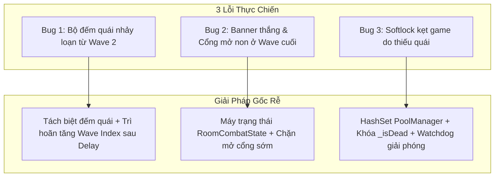
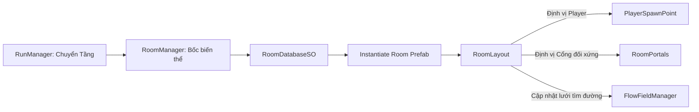

# BÁO CÁO TỔNG KẾT HỆ THỐNG HẦM NGỤC & HƯỚNG DẪN THIẾT LẬP SCENE

**Dự án:** *Project_D* (Unity 6 URP 2D Mobile Action Survivor x Dungeon Crawler)  
**Tác giả:** Antigravity AI Senior Game Developer  
**Ngày thực hiện:** 24/10/2026  

---

## MỤC LỤC

- [PHẦN 1: TỔNG KẾT YÊU CẦU 1 - KHẮC PHỤC TRIỆT ĐỂ 3 LỖI CHIẾN ĐẤU](#phần-1-tổng-kết-yêu-cầu-1---khắc-phục-triệt-để-3-lỗi-chiến-đấu)
  - [1.1. Lỗi 1: Bộ đếm quái nhảy sai lệch từ Wave 2 trở đi](#11-lỗi-1-bộ-đếm-quái-nhảy-sai-lệch-từ-wave-2-trở-đi)
  - [1.2. Lỗi 2: Banner chiến thắng và Cổng dịch chuyển mở sớm ở đầu Wave cuối](#12-lỗi-2-banner-chiến-thắng-và-cổng-dịch-chuyển-mở-sớm-ở-đầu-wave-cuối)
  - [1.3. Lỗi 3: Softlock nghiêm trọng do quái spawn thiếu khiến kẹt Wave](#13-lỗi-3-softlock-nghiêm-trọng-do-quái-spawn-thiếu-khiến-kẹt-wave)
  - [1.4. Bảng tổng hợp các file mã nguồn đã sửa chữa](#14-bảng-tổng-hợp-các-file-mã-nguồn-đã-sửa-chữa)
- [PHẦN 2: TỔNG KẾT YÊU CẦU 2 - BỘ CÔNG CỤ TẠO PHÒNG & HỆ THỐNG BIẾN THỂ PHÒNG ĐỘNG](#phần-2-tổng-kết-yêu-cầu-2---bộ-công-cụ-tạo-phòng--hệ-thống-biến-thể-phòng-động)
  - [2.1. Tầm nhìn & Kiến trúc Modul hóa (Dynamic Room Swapping)](#21-tầm-nhìn--kiến-trúc-modul-hóa-dynamic-room-swapping)
  - [2.2. Các linh kiện cốt lõi đã xây dựng](#22-các-linh-kiện-cốt-lõi-đã-xây-dựng)
  - [2.3. Bộ công cụ Unity Editor (RoomCreatorWizard)](#23-bộ-công-cụ-unity-editor-roomcreatorwizard)
- [PHẦN 3: HƯỚNG DẪN THIẾT LẬP CHI TIẾT TRONG SCENE (SCENE SETUP)](#phần-3-hướng-dẫn-thiết-lập-chi-tiết-trong-scene-scene-setup)
  - [3.1. Cách 1: Thiết lập 1-Click tự động (Khuyên Dùng - Nhanh Nhất)](#31-cách-1-thiết-lập-1-click-tự-động-khuyên-dùng---nhanh-nhất)
  - [3.2. Cách 2: Thiết lập thủ công từng bước trong Hierarchy & Inspector](#32-cách-2-thiết-lập-thủ-công-từng-bước-trong-hierarchy--inspector)
- [PHẦN 4: KỊCH BẢN CHƠI THỬ PLAYTEST & CHECKLIST NGHIỆM THU](#phần-4-kịch-bản-chơi-thử-playtest--checklist-nghiệm-thu)

---

## PHẦN 1: TỔNG KẾT YÊU CẦU 1 - KHẮC PHỤC TRIỆT ĐỂ 3 LỖI CHIẾN ĐẤU

Trong quá trình chơi thử, hệ thống phòng chiến đấu gặp phải 3 lỗi nghiêm trọng. Tôi đã tuân thủ nghiêm ngặt **nguyên tắc sửa tận gốc (Root Cause Fix)** thay vì dùng các bản vá tạm bợ:



### 1.1. Lỗi 1: Bộ đếm quái nhảy sai lệch từ Wave 2 trở đi
* **Hiện tượng:** Ở Wave 1 bộ đếm hiển thị đúng và giảm về 0, nhưng sang Wave 2 trở đi con số nhảy loạn, hiển thị âm hoặc không khớp số quái trên sàn.
* **Nguyên nhân gốc rễ:**
  1. Biến `_currentWaveIndex++` bị tăng sớm ngay khi wave trước vừa hết quái, trong khi Coroutine `DelayedNextWave` vẫn đang đếm ngược thời gian chờ (delay 2s).
  2. UI tính toán số quái dựa trên công thức lồng ghép `TotalSpawnedInRoom - TotalDefeatedInRoom`, khiến số lượng của wave cũ bị cộng dồn sang wave mới.
* **Cách khắc phục triệt để:**
  - Chỉ tăng `_currentWaveIndex++` khi thời gian chờ hoàn tất và wave mới thực sự bắt đầu xuất hiện quái.
  - Tách bạch bộ đếm theo từng Wave độc lập: `remainingToDefeat = Mathf.Max(0, _totalEnemiesInCurrentWave - _enemiesDefeatedInCurrentWave)`.
  - Cập nhật [RunHUD.cs](file:///d:/Project_D/Assets/_Project/Scripts/Dungeon/UI/RunHUD.cs) hiển thị chuẩn: `Quái: {remaining} / {totalInWave}`.

---

### 1.2. Lỗi 2: Banner chiến thắng và Cổng dịch chuyển mở sớm ở đầu Wave cuối
* **Hiện tượng:** Vừa bước vào Wave 3 (hoặc Wave cuối), banner *"PHÒNG ĐÃ DỌN SẠCH"* đã hiện lên và các Cổng dịch chuyển mở toang dù quái vật đợt cuối vừa mới bắt đầu sinh ra.
* **Nguyên nhân gốc rễ:**
  - `CheckWaveCompletion()` chỉ so sánh `_enemiesDefeatedInCurrentWave >= _totalEnemiesInCurrentWave`. Ở khoảnh khắc bắt đầu wave mới, cả hai biến này đều bằng `0` $\to$ Điều kiện vô tình thỏa mãn ngay lập tức!
* **Cách khắc phục triệt để:**
  - Xây dựng **Máy trạng thái chiến đấu (RoomCombatState Enum)** gồm: `Inactive`, `SpawningWave`, `FightingWave`, `WaveIntermission`, `RoomCompleted`.
  - Chỉ cho phép hoàn thành phòng khi trạng thái đang ở `FightingWave` **VÀ** toàn bộ số quái dự kiến đã sinh xong **VÀ** danh sách quái sống sót `_currentWaveEnemies.Count == 0`.

---

### 1.3. Lỗi 3: Softlock nghiêm trọng do quái spawn thiếu khiến kẹt Wave
* **Hiện tượng:** Game thỉnh thoảng sinh thiếu 1, 2 hoặc 3 quái, khiến số quái còn lại không thể giảm về 0, người chơi không thể hoàn thành phòng và kẹt cứng game.
* **Nguyên nhân gốc rễ kép (Dual Root Causes):**
  1. **Đột biến sát thương đa nguồn (Multi-Hit Race Condition):** Quái vật trúng đạn nổ/sát thương diện rộng trong cùng 1 frame vật lý bị gọi hàm `Die()` nhiều lần liên tiếp, kích hoạt trả về Pool nhiều lần.
  2. **Trùng lặp trong PoolManager:** Hàng đợi `Queue<GameObject>` của `PoolManager` không kiểm tra trùng lặp. Khi 1 GameObject bị `ReturnToPool` 2 lần, lúc lấy ra `Get()` nó lấy lại đúng instance đang sống $\to$ ghi đè vị trí hoặc làm biến mất con quái đang chiến đấu.
* **Cách khắc phục triệt để:**
  - Thêm cờ `_isDead` và tắt ngay `Collider2D` + triệt tiêu vận tốc `linearVelocity = Vector2.zero` trong hàm `Die()` của [EnemyController.cs](file:///d:/Project_D/Assets/_Project/Scripts/Enemies/EnemyController.cs).
  - Tích hợp `HashSet<GameObject>` trong [PoolManager.cs](file:///d:/Project_D/Assets/_Project/Scripts/Core/PoolManager.cs) để ngăn chặn $O(1)$ việc trả trùng 1 đối tượng vào Pool.
  - Bổ sung cơ chế giám sát **Watchdog** `PruneInvalidEnemies()` trong [RoomController.cs](file:///d:/Project_D/Assets/_Project/Scripts/Dungeon/Room/RoomController.cs) tự động giải phóng bộ đếm nếu có quái bị hủy bất thường.

---

### 1.4. Bảng tổng hợp các file mã nguồn đã sửa chữa

| File Script | Nội dung chỉnh sửa chính |
| :--- | :--- |
| [PoolManager.cs](file:///d:/Project_D/Assets/_Project/Scripts/Core/PoolManager.cs) | Thêm `_poolSets` (`HashSet<GameObject>`) bảo vệ chống enqueue trùng lặp. |
| [EnemyController.cs](file:///d:/Project_D/Assets/_Project/Scripts/Enemies/EnemyController.cs) | Thêm cờ `_isDead`, tắt Collider2D lập tức khi chết, bảo vệ `TakeDamage()`. |
| [ExpGem.cs](file:///d:/Project_D/Assets/_Project/Scripts/Combat/ExpGem.cs) | Thêm cờ `_isCollected` chống thu thập và trả Pool nhiều lần. |
| [EnemySpawner.cs](file:///d:/Project_D/Assets/_Project/Scripts/Enemies/EnemySpawner.cs) | Tự động tắt Spawner vô tận cũ khi có `RoomController` trong Scene. |
| [RoomController.cs](file:///d:/Project_D/Assets/_Project/Scripts/Dungeon/Room/RoomController.cs) | Refactor máy trạng thái `RoomCombatState`, quản lý quái bằng `HashSet`, Watchdog chống kẹt. |
| [RunHUD.cs](file:///d:/Project_D/Assets/_Project/Scripts/Dungeon/UI/RunHUD.cs) | Định dạng lại hiển thị tiến độ: `Đợt: {wave}/{total} - Quái: {rem}/{totalInWave}`. |

---

## PHẦN 2: TỔNG KẾT YÊU CẦU 2 - BỘ CÔNG CỤ TẠO PHÒNG & HỆ THỐNG BIẾN THỂ PHÒNG ĐỘNG

Nhằm giúp hành trình 13 tầng hầm ngục không bị đơn điệu, tôi đã xây dựng hệ thống **Tải phòng động theo biến thể (Modular Dynamic Room Swapping)** và **Bộ công cụ Editor 1-Click**:



### 2.1. Tầm nhìn & Kiến trúc Modul hóa (Dynamic Room Swapping)
- Mỗi loại phòng (`NormalBattle`, `EliteBattle`, `RestSite`, `Shop`, `BuffReward`, `BossBattle`) có thể có **nhiều biến thể kiến trúc khác nhau** (Sân mở, 4 Cột đá cản đạn, Hành lang chữ thập, Vòng tròn đá, Lửa trại ấm cúng, Quầy hàng thương nhân, v.v.).
- Khi người chơi bước qua cổng sang tầng mới:
  1. Phòng cũ được tự động dọn dẹp và hủy khỏi bộ nhớ.
  2. Bốc ngẫu nhiên 1 biến thể phòng từ `RoomDatabaseSO` (tự động **tránh trùng lặp** với biến thể vừa chơi ở phòng trước).
  3. Khởi tạo Prefab phòng mới, đặt Player vào đúng điểm xuất hiện `PlayerSpawnPoint`.
  4. Bàn giao các Cổng dịch chuyển và Điểm tương tác cho `RoomController`.
  5. Kích hoạt `FlowFieldManager.Instance.UpdateFlowField()` quét lại các bức tường/chướng ngại vật trên Layer `Obstacle ` $\to$ Quái vật di chuyển thông minh, tự động né cột đá ngay lập tức mà không bao giờ bị kẹt.

---

### 2.2. Các linh kiện cốt lõi đã xây dựng

1. **[RoomLayout.cs](file:///d:/Project_D/Assets/_Project/Scripts/Dungeon/Room/RoomLayout.cs):**
   - Thành phần gắn trên GameObject gốc của mỗi Prefab phòng.
   - Quản lý các điểm neo: `PlayerSpawnPoint`, `EnemySpawnPoints`, `Portals`, `InteractionPoints`, `ObstaclesRoot`, `FloorRoot`.
   - Tự động vẽ **Scene View Gizmos màu sắc trực quan** (Khung xám, Player xanh lá, Quái đỏ, Cổng xanh lơ, Điểm tương tác vàng).
   - Tự động sắp xếp mảng Cổng từ trái qua phải theo trục X (`AutoBindReferences`).

2. **[RoomVariationSO.cs](file:///d:/Project_D/Assets/_Project/Scripts/Dungeon/Room/RoomVariationSO.cs):**
   - ScriptableObject lưu trữ metadata của một biến thể: Tên phòng, loại node hỗ trợ, liên kết Prefab, trọng số bốc thăm `SelectionWeight` (1-100) và mô tả chiến thuật.

3. **[RoomDatabaseSO.cs](file:///d:/Project_D/Assets/_Project/Scripts/Dungeon/Room/RoomDatabaseSO.cs):**
   - Danh mục quản lý tập trung toàn bộ các biến thể phòng trong dự án.
   - Thuật toán bốc thăm ngẫu nhiên có trọng số và loại trừ phòng vừa chơi.
   - Hỗ trợ ContextMenu quét toàn bộ project tự động đưa phòng vào danh mục.
   - File dữ liệu trung tâm: [RoomDatabase.asset](file:///d:/Project_D/Assets/_Project/ScriptableObjects/Dungeon/RoomDatabase.asset).

4. **[RoomManager.cs](file:///d:/Project_D/Assets/_Project/Scripts/Dungeon/Room/RoomManager.cs):**
   - Singleton điều phối việc nạp/hủy phòng trong Scene.
   - Tích hợp cơ chế tự phục hồi `EnsureDatabase()`: Tự động tìm và nạp `RoomDatabase.asset` nếu ô Inspector bị để trống.

5. **Nâng cấp [RoomController.cs](file:///d:/Project_D/Assets/_Project/Scripts/Dungeon/Room/RoomController.cs):**
   - Tự động kiểm tra và gắn `RoomManager` vào Scene trong `Awake()`.
   - Mở Cổng đối xứng thẩm mỹ trong `OpenNextFloorPortals()`:
     - 1 Cổng: Mở đúng Cổng **Chính Giữa**.
     - 2 Cổng: Mở 2 cổng **Trái & Phải** đối xứng.
     - 3 Cổng: Mở cả 3 cổng.
   - Kẹp biên độ sinh quái trong lòng phòng qua `Mathf.Clamp` theo `RoomSize`.
   - Tự động ẩn tường thử nghiệm cũ `Wall_Test` và các cổng tĩnh cũ khi liên kết layout mới.

---

### 2.3. Bộ công cụ Unity Editor (RoomCreatorWizard)
File: [Assets/_Project/Scripts/Editor/RoomCreatorWizard.cs](file:///d:/Project_D/Assets/_Project/Scripts/Editor/RoomCreatorWizard.cs)

Được tích hợp trực tiếp vào thanh Menu của Unity Editor (**`Project_D` $\to$ `Dungeon`**):
* **Menu 1: `Room Creator Tool`:** Cửa sổ thiết kế phòng trực quan:
  - Chọn kích thước mẫu: `20x20`, `30x30`, `40x40`, `45x45` hoặc `Custom`.
  - Chọn kiểu kiến trúc & vật cản: Sân mở, 4 Cột góc, Chữ thập, Vòng tròn đá, Lửa trại, Quầy hàng, Điện thờ.
  - Tùy chỉnh màu sắc Sàn, Tường bao và Chướng ngại vật.
  - Bấm **"Tạo Phòng Trực Tiếp Vào Scene"** để xem trước hoặc bấm **"Xuất Bản Prefab + RoomVariationSO + Đăng Ký Database"** để đóng gói tự động.
* **Menu 2: `Batch Generate All 7 Rooms` (1-Click):** Tự động tạo trọn bộ 7 phòng mẫu chuẩn chỉ với 1 cú click chuột:
  1. `Room_Normal_OpenField.prefab` (30x30 - Quái thường sân mở)
  2. `Room_Normal_FourPillars.prefab` (30x30 - Quái thường 4 cột đá che chắn)
  3. `Room_Elite_Chokepoints.prefab` (34x34 - Quái Elite chữ thập chia làn)
  4. `Room_RestSite_Campfire.prefab` (20x20 - Lửa trại hồi máu)
  5. `Room_Shop_MerchantOutpost.prefab` (22x22 - Quầy hàng thương nhân)
  6. `Room_BuffReward_AltarSanctum.prefab` (24x24 - Điện thờ ban phước)
  7. `Room_Boss_Colosseum.prefab` (44x44 - Đại đấu trường Boss giác đấu)
* **Menu 3: `Setup RoomManager In Scene` (1-Click):** Tự động tạo GameObject và liên kết dữ liệu trong Scene mà không cần kéo thả thủ công.

---

## PHẦN 3: HƯỚNG DẪN THIẾT LẬP CHI TIẾT TRONG SCENE (SCENE SETUP)

### 3.1. Cách 1: Thiết lập 1-Click tự động (Khuyên Dùng - Nhanh Nhất)

Đây là phương pháp nhanh nhất, an toàn tuyệt đối và không sợ bị thiếu sót bất kỳ liên kết nào:

1. **Bước 1 (Sinh 7 phòng mẫu chuẩn):**
   - Trên thanh menu của Unity Editor, chọn:  
     **`Project_D` $\to$ `Dungeon` $\to$ `Batch Generate All 7 Rooms`**.
   - Nhấn nút **"Sinh ngay"** trên popup xác nhận.
   - *Kết quả:* 7 Prefab phòng được tạo tại `Assets/_Project/Prefabs/Dungeon/Rooms/` và tự động liên kết vào `RoomDatabase.asset`.

2. **Bước 2 (Gắn RoomManager vào Scene):**
   - Trên menu Unity Editor, chọn:  
     **`Project_D` $\to$ `Dungeon` $\to$ `Setup RoomManager In Scene`**.
   - *Kết quả:* GameObject `[RoomManager]` được tạo và tự động kéo file `RoomDatabase.asset` vào Inspector.

3. **Bước 3 (Xong & Lưu Scene):**
   - Nhấn **Ctrl + S** để lưu Scene lại. Bấm nút **Play** để tận hưởng ngay!

---

### 3.2. Cách 2: Thiết lập thủ công từng bước trong Hierarchy & Inspector

Nếu bạn muốn tự tay cấu hình hoặc tìm hiểu cấu trúc chi tiết của Scene:

#### Bước 1: Cấu trúc Cây Hierarchy Chuẩn trong Scene
```
SampleScene
├── Main Camera
├── Global Light 2D
├── Player
├── PoolManager
├── FlowFieldManager
├── DamageTextManager
│
├── [DUNGEON MANAGERS]
│   ├── RunManager                 <-- Component: RunManager.cs
│   ├── RoomManager                <-- Component: RoomManager.cs
│   └── RoomController             <-- Component: RoomController.cs
│
└── Canvas
    ├── JoystickBackground
    ├── JoystickTouchZone
    ├── HUDPanel
    ├── LevelUpPanel
    ├── GameOverPanel
    ├── RunHUDPanel                <-- Component: RunHUD.cs
    ├── RestSitePanel              <-- Component: RestSiteUI.cs
    ├── ShopPanel                  <-- Component: ShopUI.cs
    └── VictoryPanel               <-- Component: VictoryUI.cs
```

#### Bước 2: Thiết lập `RunManager`
1. Tại Hierarchy, nhấp chuột phải $\to$ chọn **Create Empty** $\to$ đổi tên thành **`RunManager`**.
2. Chọn `RunManager`, sang Inspector $\to$ bấm nút **Add Component** $\to$ chọn [RunManager.cs](file:///d:/Project_D/Assets/_Project/Scripts/Dungeon/Run/RunManager.cs).
3. **Cấu hình trên Inspector:**
   - **Map Config:** Để trống (`None`). *(Code sẽ tự động tạo đồ thị 13 tầng chuẩn khi chạy)*.
   - **Current Floor:** `1`.
   - **Current Souls:** `0`.

#### Bước 3: Thiết lập `RoomManager`
1. Tại Hierarchy, nhấp chuột phải $\to$ chọn **Create Empty** $\to$ đổi tên thành **`RoomManager`**.
2. Bấm **Add Component** $\to$ chọn [RoomManager.cs](file:///d:/Project_D/Assets/_Project/Scripts/Dungeon/Room/RoomManager.cs).
3. **Cấu hình trên Inspector:**
   - **Room Database:** Kéo file asset [RoomDatabase.asset](file:///d:/Project_D/Assets/_Project/ScriptableObjects/Dungeon/RoomDatabase.asset) (tại `Assets/_Project/ScriptableObjects/Dungeon/`) vào ô này.
   - **Room Container:** Có thể để trống (`None`), script sẽ tự tạo container gom gọn khi Play.

#### Bước 4: Thiết lập `RoomController`
1. Tại Hierarchy, chọn GameObject **`RoomController`** (đã có sẵn trong Scene).
2. Kiểm tra component [RoomController.cs](file:///d:/Project_D/Assets/_Project/Scripts/Dungeon/Room/RoomController.cs):
   - **Fallback Enemy Types:** Kéo file `Zombie_Data` (trong `Assets/_Project/ScriptableObjects/Enemies/`) vào ô này.
   - **Min Spawn Radius:** `8`.
   - **Max Spawn Radius:** `12`.
   - Các ô Wave Config và Portal Visual Config: Để trống (`None`), code sẽ tự động tạo cấu hình sóng 3 Wave / 4 Wave và bộ Icon phù hợp.

> [!NOTE]
> **Không cần tạo thủ công các Cổng hay Điểm Tương Tác trong Scene nữa:**  
> Khi `RoomManager` nạp Prefab của phòng (ví dụ `Room_Normal_FourPillars`), các Cổng dịch chuyển và Điểm tương tác đã được tích hợp sẵn bên trong Prefab đó và tự động kết nối với `RoomController`. Mọi vật thể tĩnh cũ như `Wall_Test` sẽ được tự động ẩn đi.

---

## PHẦN 4: KỊCH BẢN CHƠI THỬ PLAYTEST & CHECKLIST NGHIỆM THU

Sau khi thiết lập xong, bấm nút **Play** trong Unity Editor để kiểm thử theo checklist sau:

- [ ] **Khởi đầu Tầng 1 (Quái Thường):**
  - [ ] Phòng đấu trường ngẫu nhiên được sinh ra tại tâm Scene.
  - [ ] Player xuất hiện đúng tại điểm `PlayerSpawnPoint`.
  - [ ] Góc trên màn hình hiển thị: `TẦNG 1 / 13 - Quái Thường`.
  - [ ] Wave 1 sinh 6 quái vật. Tiêu diệt quái $\to$ Souls cộng thẳng vào quỹ tiền không cần nhặt đồ.
  - [ ] Bộ đếm hiển thị chính xác: `Quái: 6 / 6` $\to$ giảm đều đặn về `0 / 6`.
  - [ ] Hết Wave 1 $\to$ Chờ 2 giây $\to$ Chuyển sang Wave 2 (10 con) $\to$ Wave 3 (15 con).
- [ ] **Hoàn thành Tầng 1 (Room Cleared):**
  - [ ] Diệt sạch con quái cuối cùng ở Wave 3 $\to$ Hiện banner `"PHÒNG ĐÃ DỌN SẠCH!"`.
  - [ ] Toàn bộ ngọc Exp còn sót trên sàn tự động bay về người chơi.
  - [ ] **Đúng 1 Cổng Dịch Chuyển xuất hiện ở chính giữa phòng** (`[ GIFT ] Tầng 2: Thưởng Khởi Đầu`).
- [ ] **Chuyển sang Tầng 2 (Thưởng Khởi Đầu - Phi Chiến Đấu):**
  - [ ] Bước vào Cổng $\to$ Phòng Tầng 1 cũ bị hủy $\to$ Phòng Tầng 2 mới được nạp vào.
  - [ ] Người chơi được đưa về điểm xuất hiện của phòng mới.
  - [ ] Bệ thờ Buff xuất hiện ở giữa phòng.
  - [ ] **Mở sẵn 2 Cổng Dịch Chuyển đối xứng ở 2 bên Trái và Phải** (`Tầng 3A` và `Tầng 3B`).
- [ ] **Chuyển sang Tầng 3 (Quái Thường):**
  - [ ] Bước vào 1 trong 2 cổng $\to$ Phòng mới thuộc loại Quái Thường (có thể là biến thể 4 cột đá hoặc sân mở khác phòng Tầng 1) được nạp.
  - [ ] Quái vật di chuyển thông minh vòng qua các cột đá nhờ FlowField để săn đuổi người chơi, không bị kẹt hay đi xuyên tường.
- [ ] **Chuyển sang Tầng 4 (Phân 3 Nhánh: Shop, Buff, Rest):**
  - [ ] Diệt sạch quái Tầng 3 $\to$ Xuất hiện đầy đủ cả **3 Cổng Dịch Chuyển** (Trái, Giữa, Phải).
  - [ ] Bước vào Cổng Shop $\to$ Quán thương nhân xuất hiện $\to$ Chạm vào quầy mở bảng mua sắm bằng Souls mượt mà!
